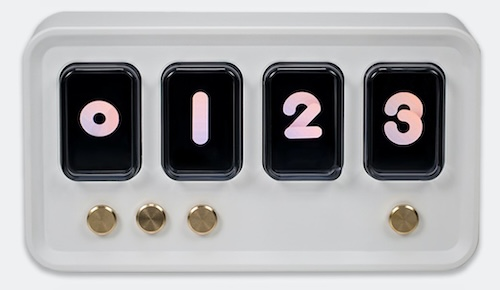

# Hardware

Small white EleksTube IPS (2021–2022), 4 IPS panels and 4 buttons. Electrically
the same as the original 6-digit EleksTube IPS (EleksTubeHAX
`HARDWARE_ELEKSTUBE_CLOCK`), minus two panels and the RGB LEDs. Not to be
confused with the newer tube-shaped EleksTube models; their firmware (e.g.
"EleksTube IPS Gen3") boots on this board but drives the wrong pins, so the
panels glow without content and the buttons do nothing.

## MCU

- ESP32-D0WD rev 1.0 (WROOM module), dual core, 240 MHz, no PSRAM
- 4 MB flash, 40 MHz crystal
- USB serial built in (shows up as `/dev/cu.usbserial-*`); auto-reset works
- Long serial reads (`esptool read-flash`) drop bytes at any baud; 64 KB
  chunks at 115200 work. Writes are fine (verified by hash).

## Pins

| Function | GPIO | Notes |
|---|---|---|
| TFT SPI SCLK | 18 | Shared by all panels |
| TFT SPI MOSI | 23 | Shared; no MISO |
| TFT DC | 25 | Shared |
| TFT RST | 26 | Shared: one reset hits every panel |
| TFT power | 27 | MOSFET, active high. Cutting it wipes panel init state |
| 74HC595 data | 14 | Panel chip selects |
| 74HC595 clock | 16 | |
| 74HC595 latch | 17 | |
| Button LEFT | 33 | Active low, external pull-up |
| Button MODE | 32 | Active low, external pull-up |
| Button RIGHT | 35 | Active low, external pull-up, input-only pin |
| Button POWER | 34 | Active low, external pull-up, input-only pin |
| I2C SDA | 21 | RTC |
| I2C SCL | 22 | RTC |

Physical buttons, left to right: LEFT, MODE, RIGHT, then POWER on its own
(names follow EleksTubeHAX).

GPIO12 drives the WS2812 LEDs behind the panels on the 6-digit board; this unit
has none.

## Panels

- 4 × ST7789, 135 × 240 portrait, same panel as the LilyGO T-Display
- ESPHome `mipi_spi` model `ST7789V`, offsets 52 (width) / 40 (height),
  `invert_colors: true`, 40 MHz
- No direct CS lines: each panel's CS is a 74HC595 output, **active low**
  - Q0 = leftmost panel … Q3 = rightmost (verified)
  - Shift MSB first so byte bit n lands on Qn; write `~mask` (bit set = selected)
  - On the 6-digit board panels are Q0–Q5 (EleksTubeHAX shifts
    `(~map) << 2` LSB first)

### Driving them from ESPHome

- One display component for all panels, no `cs_pin`. Select a panel via the
  595, then call `update()` (synchronous). One framebuffer is reused, so a
  partial buffer (`buffer_size: 25%`) is plenty.
- Separate display components per panel don't work: the ESP32 SPI driver
  allows only 3 devices per bus (`Add device failed`).
- Select all panels (mask `0xFF`) before the display's setup so the reset
  and init sequence reach every panel at once.
- Don't use the `T-DISPLAY` model preset: it also claims GPIO5 as CS.
- Turning panel power (GPIO27) off and on requires re-running the full init
  sequence; the original firmware does this in `TFTs::reinit()`. Stock
  `mipi_spi` can't re-init without a reboot. Panel sleep commands (DISPOFF /
  SLPIN) or a custom component are the way to do screen on/off and dimming.

## RTC

- DS3231 at I2C `0x68`
- ESPHome `ds1307` time platform works with it
- Shipped with an unset time (read as 2024-01-01)

## Budget

- App partition 1.75 MB (ESPHome default 4 MB OTA layout)
- RAM ~180 KB static; ~130 KB free with Wi-Fi, API and a 25% display buffer
- A full-colour 135 × 240 image is ~65 KB (RGB565); 10 digits ≈ 650 KB
  flash. Runtime images (`online_image`) need the same in RAM each.

## References

- [EleksTubeHAX](https://github.com/aly-fly/EleksTubeHAX) —
  `include/GLOBAL_DEFINES.h` (pin map), `src/ChipSelect.cpp`,
  `src/TFTs.cpp`; its prebuilt `FW_EleksTube_v1.3.14.bin` targets this board
- [upiir/elekstube_ips_custom_theme](https://github.com/upiir/elekstube_ips_custom_theme)
  — 135 × 240 PNG digit themes (MIT)
